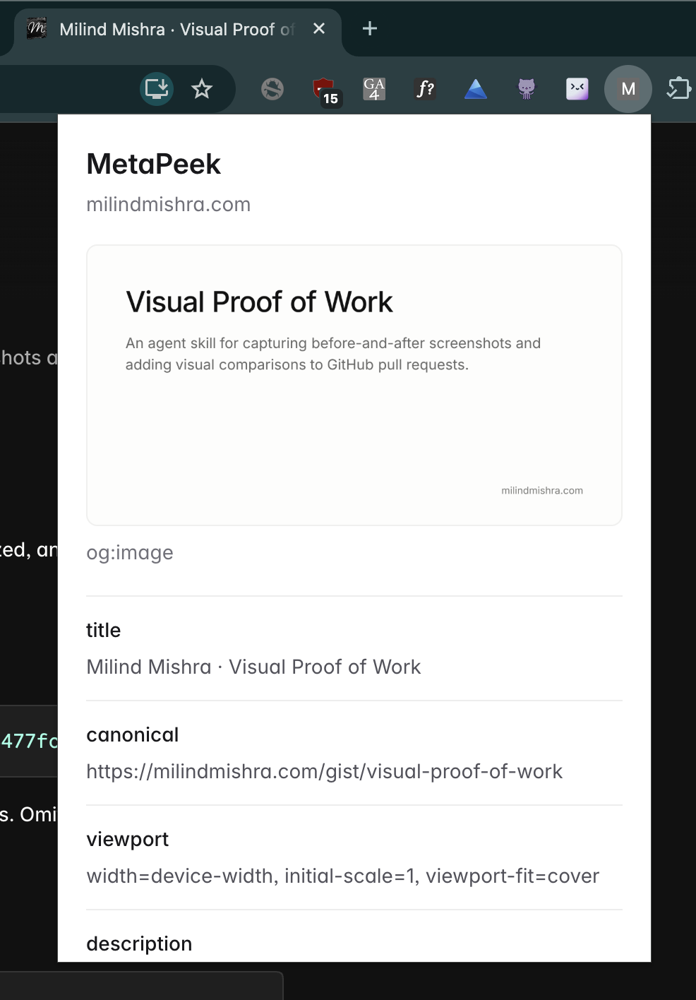

# MetaPeek

Shows the current page’s OG image and metadata in a Chrome popup.

Screenshot from 0.0.1

## Install

1. [Download metapeek.zip](https://github.com/thatbeautifuldream/metapeek/releases/latest/download/metapeek.zip) and unzip it.
2. Open `chrome://extensions` and enable **Developer mode**.
3. Click **Load unpacked** and select the extracted `metapeek` folder.
4. Open a website and click MetaPeek in Chrome’s extensions menu.

Keep the extracted folder. Chrome loads the extension from it.

Fixed-size popup with the site’s favicon, OG image, and scrollable metadata. Long values scroll inside their rows.

Shows OG and Twitter tags, title, description, canonical URL, and robots tags. Reopen the popup to refresh. Chrome internal pages and the Web Store are restricted.

No build step, account, or analytics. Uses `activeTab` and `scripting` permissions. OG images load from their original host.

Inter font license: [fonts/LICENSE.txt](fonts/LICENSE.txt).
